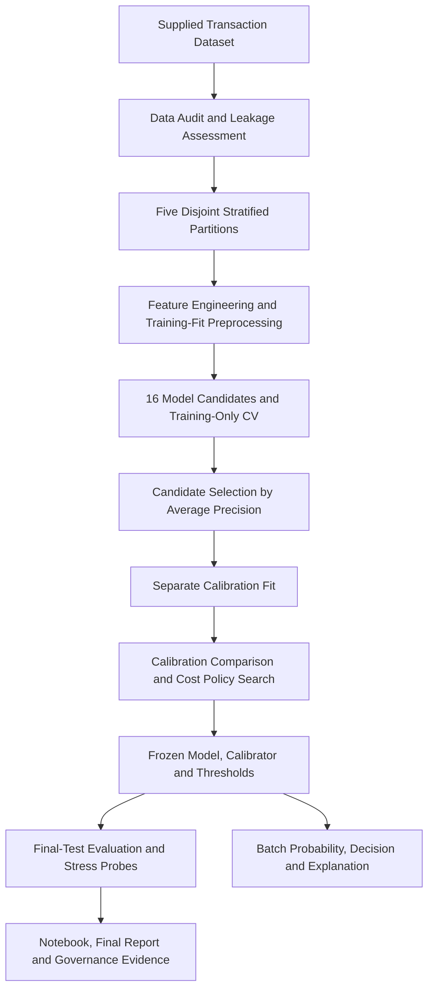
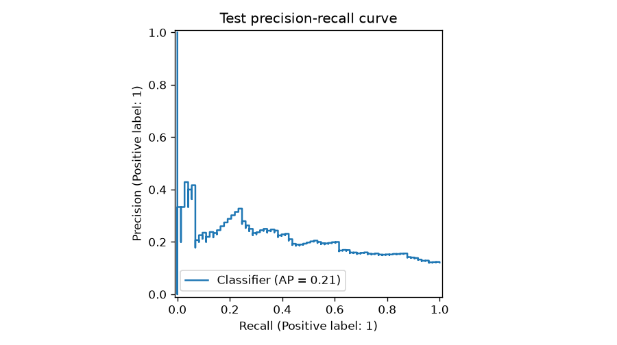

<div align="center">

<h1>Fraud Risk Intelligence Pipeline</h1>

<p>
  <strong>Detect suspicious transactions, explain fraud risk, and balance financial loss, customer friction, and review capacity.</strong>
</p>

<p>
  
  
  
  
  
  
</p>

<p>
  <a href="business_fraud_strategy.pdf"><strong>Final Business Report</strong></a> &nbsp;|&nbsp;
  <a href="fraud_risk_analysis.ipynb">Analysis Notebook</a> &nbsp;|&nbsp;
  <a href="model_card.pdf">Model Card</a> &nbsp;|&nbsp;
  <a href="docs/requirements_checklist.md">Requirements Checklist</a>
</p>

</div>

---

<h2 align="center">About the Project</h2>

**Fraud Risk Intelligence Pipeline** is an analytics and machine learning project that evaluates how a financial platform could identify suspicious online and card transactions while controlling false positives.

The project covers the complete offline workflow: data auditing, exploratory analysis, feature engineering, imbalanced classification, probability calibration, cost-sensitive threshold selection, explainability, operational simulation, stress testing, and model governance.

Each scored transaction receives a fraud probability and an **Approve / Manual Review / Block** decision. Flagged transactions also receive an explanation. The policy considers hypothetical fraud losses, customer friction, analyst costs, and limited review capacity.

> [!IMPORTANT]
> **Current status: offline assessment prototype.** The dataset has no reliable event timestamp, label timestamp, or customer identifier. Results do not establish future-period performance or production readiness. Costs and review outcomes are hypothetical; live payment decisions require further validation and approval.

---

<h2 align="center">Core Features</h2>

<table>
<tr>
<td width="50%" valign="top">

### Data Quality & Exploratory Analysis

- Schema, missingness, duplicates, and cardinality audit
- Range checks and inconsistent-value investigation
- Missingness versus fraud-rate analysis
- Fraud patterns across transaction and customer segments
- Nonlinear amount, velocity, distance, and risk analysis
- 31 analytical figures, including interaction heatmaps

</td>
<td width="50%" valign="top">

### Feature Engineering & Modelling

- 18 derived features with documented definitions
- Velocity, time, risk, and device interactions
- Training-fold normalisation and deviation features
- Logistic regression, random forest, and extra trees
- 16 candidates and reproducible hyperparameter searches
- Original-versus-engineered feature comparisons

</td>
</tr>
<tr>
<td width="50%" valign="top">

### Imbalance & Probability Calibration

- Unweighted and class-weighted comparisons
- Fit-only undersampling around preprocessing and modelling
- Three-fold training diagnostics and variability
- Sigmoid and isotonic calibration comparisons
- Brier score, log loss, slope, and risk bands
- Separate calibration-fit and policy-selection partitions

</td>
<td width="50%" valign="top">

### Cost-Sensitive Fraud Decisions

- Approve, manual review, and block actions
- Joint review/block threshold optimisation
- Nine cost and capacity sensitivity settings
- Cross-model business-cost comparisons
- Recall versus analyst-workload analysis
- Simulated fraud capture and customer-friction estimates

</td>
</tr>
<tr>
<td width="50%" valign="top">

### Explainability & Robustness

- Global permutation importance and fold stability
- Dependence and interaction analysis
- Five example transaction explanations
- Local explanations for every review/block prediction
- Amount, velocity, missingness, and channel stress tests
- Extreme-value and fraud-prevalence simulations

</td>
<td width="50%" valign="top">

### Reporting & Governance

- Executed notebook and supporting evidence
- Professional 12-page final business report
- Model card and feature-availability assumptions
- Monitoring metrics, proposed owners, and drift triggers
- Retraining, disablement, and rollback guidance
- Saved decision engine and standalone batch inference

</td>
</tr>
</table>

---

<h2 align="center">Project Objectives</h2>

- Assess data quality and potential leakage before modelling.
- Identify fraud associations across channels, authentication, devices, and customer segments.
- Compare transparent and nonlinear classifiers under class imbalance.
- Evaluate the operational reliability of predicted probabilities.
- Select review and block thresholds using business costs and capacity constraints.
- Quantify fraud capture, legitimate-customer burden, workload, and simulated cost.
- Explain model behaviour and test sensitivity to controlled input changes.
- Deliver reproducible artifacts and an evidence-based governance roadmap.

---

<h2 align="center">Technology Stack</h2>

| Category | Technology | Purpose |
|---|---|---|
| Programming | Python | Modular analysis, reporting, and batch scoring |
| Data processing | Pandas, NumPy | Auditing, transformations, features, and numerical calculations |
| Machine learning | Scikit-learn | Pipelines, classifiers, calibration components, tuning, and evaluation |
| Scientific computing | SciPy | Scientific computing dependency in the analytical environment |
| Visualisation & reporting | Matplotlib | Charts and PDF report generation |
| Notebook artifacts | nbformat | Notebook creation, validation, and saved executed outputs |
| Model persistence | Joblib | Saved preprocessing, models, calibration, and policy artifacts |
| Verification | Pytest | Regression checks for costs, fitting boundaries, inference, and outputs |
| Version control | Git & GitHub | Source history, documentation, and project delivery |

The measured environment used **Python 3.11.9**. Tested direct dependency versions are in [requirements-lock.txt](requirements-lock.txt); versions, seeds, and the data hash are recorded in [environment.json](reports/environment.json).

---

<h2 align="center">Analytical Architecture</h2>



Population references, imputation, scaling, and encoding are fitted inside the relevant training pipeline. The undersampling wrapper samples only its own fit rows. The target (`fraud`) and identifier (`transaction_id`) are excluded from predictors.

---

<h2 align="center">Dataset & Validation Design</h2>

The supplied dataset contains **3,000 transactions**, **25 columns**, and **364 fraud labels (12.13%)**. Raw data belongs in `data/raw/` and is excluded from Git. Its original provenance has not been independently verified.

| Partition | Transactions | Fraud Labels | Purpose |
|---|---:|---:|---|
| Training | 1,500 | 182 | Fit models and preprocessing; training-only cross-validation |
| Model selection | 450 | 55 | Compare candidates by average precision |
| Calibration fit | 225 | 27 | Fit sigmoid and isotonic mappings |
| Policy selection | 225 | 27 | Compare calibration methods and optimise thresholds |
| Final test | 600 | 73 | Evaluate the frozen candidate and policy |

**Splits are stratified, not chronological.** Policy-selection rows support both calibration-method choice and threshold search, so development cost estimates may be optimistic. Final-test labels were excluded from fitting and selection, but this same test partition was inspected before the revision. Repeated reporting is regression evidence, not a fresh untouched evaluation.

Seeds **42-45**, the [partition manifest](reports/split_manifest.csv), and the data hash document reproduction. Tuned-candidate fold summaries reuse training-selected hyperparameters and are descriptive rather than nested-CV estimates.

---

<h2 align="center">Model Performance</h2>

The selected candidate is **unweighted logistic regression with original features and sigmoid calibration**. Candidate selection used development average precision; the final-test results below describe the frozen choice.

| Final-Test Metric | Result |
|---|---:|
| ROC-AUC | 0.6515 |
| Average precision | 0.2110 |
| Test prevalence / no-skill AP reference | 0.1217 |
| Brier score | 0.1053 |
| Calibration slope; ideal = 1 | 3.30 |
| Expected calibration error; 8 quantile bands | 0.0488 |
| Flag precision / recall / F1 | 0.1988 / 0.4658 / 0.2787 |

Review or block counts as a positive flag. The model flags **34 of 73 frauds**, while **39 frauds are approved**. The calibration slope shows that a fitted mapping has not established reliable probabilities; the calibration-fit partition has only 27 fraud cases.



<details>
<summary><strong>Development candidate comparison</strong></summary>

These scores use the **450-row model-selection partition**, not the final test.

| Candidate | ROC-AUC | Average Precision |
|---|---:|---:|
| Logistic / original | 0.6603 | **0.2891** |
| Logistic / weighted original | 0.6451 | 0.2660 |
| Logistic / engineered | **0.6761** | 0.2614 |
| Extra trees / engineered | 0.6513 | 0.2555 |
| Logistic / tuned original | 0.6606 | 0.2526 |
| Random forest / tuned engineered | 0.6518 | 0.2456 |
| Logistic / undersampled original | 0.6692 | 0.2330 |

See the [full comparison](reports/model_comparison.csv), [fold summaries](reports/candidate_cv_summary.csv), and [imbalance comparison](reports/imbalance_comparison.csv).

</details>

---

<h2 align="center">Fraud Decision & Cost Framework</h2>

| Decision | Selected Probability Rule | Operational Interpretation |
|---|---|---|
| **Approve** | Below 12.4193% | Continue under the simulated policy |
| **Manual Review** | 12.4193% to below 13.2910% | Route to an analyst queue |
| **Block** | At or above 13.2910% | Simulate a decline |

Displayed thresholds are rounded; the engine uses full precision. An otherwise approved transaction with missing amount goes to review. It can still be blocked when its score meets the block threshold.

| Hypothetical Assumption | Base Setting |
|---|---|
| Approved fraud loss | Transaction amount x 1 |
| Review labour / legitimate-review friction | 3 / 2 cost units |
| Review interception success | 80% |
| Legitimate-block friction / residual fraud-block cost | 25 / 1 cost units |
| Missing-amount fraud-loss fallback | 100 cost units |
| Review allowance | 15% of each batch |

One cost is assigned per transaction. Approval incurs assumed fraud loss; review incurs labour plus legitimate friction or residual fraud loss; blocking incurs legitimate friction or residual fraud-block cost. Cost units have no verified currency.

The [configuration](configs/cost.json), [threshold grid](threshold_cost_analysis.csv), and [nine sensitivity settings](reports/cost_assumptions.json) state the assumptions. Capacity is a simulation constraint, not an implemented queue scheduler or staffing SLA.

---

<h2 align="center">Business Findings</h2>

| Final-Test Outcome | Result |
|---|---:|
| Approved / reviewed / blocked | 429 / 79 / 92 |
| Legitimate transactions flagged / blocked | 137 / 71 |
| Review share | 13.17% |
| Assumption-adjusted fraud capture | 43.01% |
| Selected policy cost / transaction | 15.36 units |
| Approve-all cost / transaction | 20.51 units |
| Simulated cost reduction versus approve-all | 25.1% |

The simulated difference is **3,087.09 units across 600 test transactions**, conditional on observed labels and the stated intervention assumptions. It is not observed savings. **71 of 92 blocks are legitimate**, so customer impact remains material.

A review-only policy costs less at **14.35 units per transaction**, but needs **171 reviews against an allowance of 90**. It is infeasible under the base capacity setting.

Predictive and business rankings differ. Under doubled fraud-loss costs, a weighted engineered forest has lower selection AP than the logistic baseline (**0.1992 versus 0.2891**) but lower optimised development cost (**16.83 versus 21.01 units per transaction**). Comparisons use a common sigmoid method and optimised development policies; they are not independent test savings. The AP-selected logistic candidate remains the reference model.

See the [final report](business_fraud_strategy.pdf), [business-question answers](reports/assessment_answers.md), [cross-model costs](reports/model_cost_comparison.csv), and [recall/workload sweep](reports/recall_review_workload.csv).

---

<h2 align="center">Explainability, Robustness & Governance</h2>

| Area | Implemented Evidence | Interpretation |
|---|---|---|
| Global predictors | Permutation importance and fold stability | Model reliance varies across samples and correlated inputs |
| Local explanations | Five examples and explanations for every review/block | Base-logit terms are not calibrated-probability or causal contributions |
| Distribution shifts | Amount, velocity, channel, extreme-value, and prevalence probes | Artificial perturbations retain labels; they do not predict real adaptation |
| Missing-input sensitivity | Operational fallback with newly masked amounts | Masking 10% of amounts increases reviews from 79 to 126, exceeding capacity |
| Monitoring | Input quality, drift, queue, mature-label performance, calibration, loss, and latency | Proposed triggers and owners require approval |
| Governance response | Review, retrain/recalibrate, disable blocking, and restore an approved bundle | Documented proposals, not deployed controls |

Logistic explanations display the intercept and largest signed terms; omitted terms still contribute to the score. The tree fallback uses nonadditive single-field ablations. Customer-facing decline reasons require separate review.

Read the [feature dictionary](docs/feature_dictionary.md), [robustness protocol](docs/robustness_protocol.md), and [monitoring plan](docs/deployment_and_monitoring.md) for definitions, availability assumptions, and proposed responses.

---

<h2 align="center">Project Deliverables</h2>

| Deliverable | Description |
|---|---|
| [fraud_risk_analysis.ipynb](fraud_risk_analysis.ipynb) | Executed notebook with 20 main sections and extended evidence |
| [processed_dataset.csv](processed_dataset.csv) | Source rows and engineered columns with training-fit population references |
| [fraud_model_pipeline.joblib](fraud_model_pipeline.joblib) | Base artifact; `pipeline` entry accepts raw transaction frames |
| [calibrated_model.joblib](calibrated_model.joblib) | `engine` entry bundles features, preprocessing, model, calibration, policy, and costs |
| [threshold_cost_analysis.csv](threshold_cost_analysis.csv) | Joint threshold search and sensitivity results |
| [model_card.pdf](model_card.pdf) | Governance summary, assumptions, limitations, and known risks |
| [business_fraud_strategy.pdf](business_fraud_strategy.pdf) | Standalone 12-page final report explaining the project and recommendations |
| [README.md](README.md) | Setup, execution, results, assumptions, and reproducibility instructions |

Supporting CSVs and figures in `reports/` preserve the analysis evidence. Some notebook cells and tests depend on them; keep them with the submission. Deliverables use descriptive filenames without numbered duplicates.

---

<h2 align="center">Repository Structure</h2>

```text
fraud-risk-intelligence-pipeline/
|-- configs/cost.json               # Hypothetical costs and capacity
|-- data/raw/                       # Supplied CSV; excluded from Git
|-- docs/                           # Features, requirements and governance
|-- reports/                        # Evidence, figures and manifests
|-- scripts/
|   |-- run_analysis.py             # Complete experiment and artifacts
|   |-- build_business_report.py    # Final PDF from saved evidence
|   `-- predict_transactions.py     # Batch scoring
|-- src/fraud_pipeline/
|   |-- core.py                     # Features, models and decisions
|   |-- assessment.py               # Additional analyses and plots
|   `-- business_report.py          # Final report content and layout
|-- tests/test_core.py              # Regression checks
|-- requirements.txt               # Supported dependency ranges
|-- requirements-lock.txt          # Tested direct dependency versions
`-- [analysis and model deliverables listed above]
```

---

<h2 align="center">Getting Started</h2>

**Requirements:** Python 3.10+ and the supplied `transaction_fraud_risk_advanced_dataset.csv`. Python **3.11.9** is the measured reference environment.

### 1. Prepare the Environment

```powershell
python -m venv .venv
.venv\Scripts\Activate.ps1
python -m pip install -r requirements-lock.txt
```

If the environment is already active, skip creation and activation. On macOS/Linux, activate with `source .venv/bin/activate`. Use `requirements.txt` for supported dependency ranges instead of the tested versions.

### 2. Add the Dataset & Run the Analysis

Place the CSV at `data/raw/transaction_fraud_risk_advanced_dataset.csv`, then run:

```powershell
python scripts/run_analysis.py
```

For a different source path:

```powershell
python scripts/run_analysis.py --data "path\to\transaction_fraud_risk_advanced_dataset.csv"
```

This rebuilds the evidence, models, thresholds, PDFs, and notebook. Running the generated notebook also rebuilds outputs from source. Update its `source` variable if you move the CSV. Interactive notebook use requires a separately installed Jupyter environment, such as `jupyterlab` and `ipykernel`.

### 3. Score Transactions

```powershell
python scripts/predict_transactions.py path\to\new_transactions.csv path\to\predictions.csv
```

Input needs the original predictor fields and `transaction_id`; a fraud label is unnecessary. Output includes a UTC timestamp, probability, decision, reason code, flagged-case explanation, model version, data warning, and assumption-based expected cost.

```python
import sys
import joblib
import pandas as pd

sys.path.insert(0, "src")
transactions = pd.read_csv("path/to/new_transactions.csv")
engine = joblib.load("calibrated_model.joblib")["engine"]

probabilities = engine.predict_proba(transactions)
decisions = engine.predict(transactions)
```

Load Joblib artifacts only from trusted sources. Start new modelling experiments from the raw CSV, not the processed export, so population references are refitted within the appropriate folds.

### 4. Rebuild the Report & Run Checks

```powershell
# Refresh the final PDF from saved evidence
python scripts/build_business_report.py

# Verify the pipeline and artifacts
python -m pytest tests/ -q
```

Page previews are saved in `reports/business_report_preview/`. The latest verified suite has **14 passing tests**, and batch inference successfully scored **3,000 transactions**.

<details>
<summary><strong>Installation troubleshooting</strong></summary>

For package-index or download timeouts:

```powershell
python -m pip install -r requirements-lock.txt --timeout 120 --retries 2
```

Check access to `pypi.org` and `files.pythonhosted.org` if downloads continue to stall. Avoid recreating `.venv` while it is active, because its Python executable may be in use.

</details>

---

<h2 align="center">Limitations & Next Steps</h2>

| Current Limitation | Required Next Step |
|---|---|
| No reliable transaction or label chronology | Collect timestamps; enforce label maturity and chronological validation |
| No customer key or verified historical lineage | Obtain identifiers and prove historical fields were available before authorization |
| Small calibration sample and weak final-test slope | Validate and recalibrate on larger, later-period mature-label samples |
| Hypothetical losses, friction, and review outcomes | Measure actual fraud exposure, customer harm, analyst cost, and interception success |
| High legitimate-block burden | Validate customer impact and revised policies in prospective shadow operation |
| Reused test partition and shared policy-selection tasks | Obtain a fresh holdout and additional independent policy validation |
| Proposed monitoring and rollback | Assign approved owners, implement alerts and fallback rules, and rehearse rollback |

Before live integration, complete prospective shadow evaluation, fairness and customer-impact review, capacity assessment, and model-risk approval. This prototype must not independently authorize or block payments.

The [requirements checklist](docs/requirements_checklist.md) maps the original brief to implemented evidence and remaining data-dependent limits.

---

<div align="center">

<h3>Fraud Risk Intelligence Pipeline</h3>

<p>From transaction data to explainable risk scores and evidence-based fraud decisions.</p>

<p><strong>Fraud Analytics &middot; Cost-Sensitive Decisions &middot; Model Governance</strong></p>

</div>
