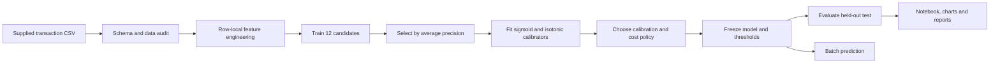

# Fraud Risk Intelligence Pipeline

**Calibrated fraud scoring, three-action decisions, and cost-aware evaluation on a supplied transaction dataset.**

| Dataset | Fraud prevalence | Selected model | Held-out average precision | Status |
| :--- | :--- | :--- | ---: | :--- |
| 3,000 transactions | 364 / 3,000 (12.13%) | Logistic regression + sigmoid calibration | 0.2110 | Offline assessment prototype |

> [!IMPORTANT]
> This is an offline decision simulation. The dataset has no reliable event timestamp or customer ID, so the results **do not establish future-period performance or production readiness**. Costs and review outcomes are explicitly hypothetical.

## What It Does

The pipeline reads transaction records, audits missing and duplicate data, builds row-local features, compares classifiers, calibrates fraud probabilities, and assigns one of three decisions:

| Decision | Rule | Operational interpretation |
| :--- | :--- | :--- |
| `APPROVE` | Probability below review threshold | Continue under the simulated policy |
| `REVIEW` | At or above review threshold, below block threshold | Route to an analyst queue |
| `BLOCK` | At or above block threshold | Simulate a decline |

The selected thresholds are **0.1242 for review** and **0.1329 for block**, chosen by searching hypothetical cost and review-capacity settings on development data. They are not universal fraud thresholds.

### Project Highlights

- **12 candidates:** logistic regression, random forest, and extra trees; original versus engineered features; unweighted versus class-weighted learning.
- **13 derived features:** amount and merchant-risk interactions, device-distance interaction, velocity ratios, age flags, time indicators, and other row-local signals.
- **Separated evaluation:** train, model selection, calibration fit, policy selection, and untouched final test partitions.
- **Decision economics:** jointly optimized review/block thresholds, five illustrative cost scenarios, and a 15% review-capacity constraint.
- **Analysis outputs:** 15 figures, permutation importance, five local base-model explanations, controlled perturbations, an executed notebook, a model card, and a 10-page strategy report.
- **Batch inference:** a separate command loads trusted artifacts and emits probability, decision, warning, version, and assumption-based expected cost.

## Results at a Glance

The final test partition contains **600 transactions, including 73 fraud labels**. These figures were generated by the executed local experiment.

| Held-out test metric | Result |
| :--- | ---: |
| ROC-AUC | 0.6515 |
| Average precision | 0.2110 |
| Brier score | 0.1053 |
| Precision at review threshold | 0.2025 |
| Recall at review threshold | 0.4384 |
| Approved / reviewed / blocked | 442 / 66 / 92 |
| Legitimate transactions blocked | 71 |
| Simulated policy cost per transaction | 15.19 cost units |
| Simulated approve-all cost per transaction | 20.17 cost units |

The cost difference is a **counterfactual simulation conditional on the dataset labels**, not observed savings. Cost units have no verified currency. The base scenario assumes review labor cost 3, legitimate-review friction 2, legitimate-block cost 25, review interception success of 80%, and capacity for reviews equal to 15% of transactions. See [cost configuration](configs/cost.json) and the [threshold grid](threshold_cost_analysis.csv).


<details>
<summary>Selection-partition model comparison</summary>

Models were chosen by average precision on **450 selection rows**. These are development scores, not final-test scores for each candidate.

| Candidate | ROC-AUC | Average precision |
| :--- | ---: | ---: |
| Logistic, unweighted, original features | 0.6603 | **0.2891** |
| Logistic, weighted, original features | 0.6451 | 0.2660 |
| Logistic, unweighted, engineered features | **0.6780** | 0.2642 |
| Random forest, unweighted, engineered features | 0.6655 | 0.2546 |

The candidate with the highest ROC-AUC was not the one selected by average precision. See the [full model comparison](reports/model_comparison.csv).

</details>

## How the Pipeline Works



| Partition | Rows | Fraud cases | Used for |
| :--- | ---: | ---: | :--- |
| Train | 1,500 | 182 | Fit preprocessing and candidate models |
| Model selection | 450 | 55 | Compare candidates by average precision |
| Calibration fit | 225 | 27 | Fit sigmoid and isotonic mappings |
| Policy selection | 225 | 27 | Compare mappings and search thresholds |
| Final test | 600 | 73 | Evaluate the frozen choice once |

The splits are **stratified, not chronological**. The policy-selection partition is used for both calibration-method comparison and threshold optimization, so its development cost estimate may be optimistic. The final-test labels were not used for those choices.

### Cost Accounting

The operational simulation assigns one cost per transaction to avoid double counting:

```text
APPROVE: fraud -> amount x fraud-loss multiplier; legitimate -> 0
REVIEW: review labor + legitimate friction, or residual fraud loss after assumed interception
BLOCK:  legitimate block friction, or residual fraud-block cost
```

The implementation and configuration are in [core.py](src/fraud_pipeline/core.py) and [cost.json](configs/cost.json). The threshold grid records workload, fraud capture, legitimate blocks, and total cost under several assumptions.

## Quick Start

**Prerequisites:** Python 3.10+ and the supplied `transaction_fraud_risk_advanced_dataset.csv`. The dataset's original provenance has not been independently verified.

1. Create an environment and install the project dependencies:

   ```powershell
   python -m venv .venv
   .venv\Scripts\Activate.ps1
   pip install -r requirements.txt
   ```

   On macOS/Linux, activate with `source .venv/bin/activate`.

2. Put the CSV at `data/raw/transaction_fraud_risk_advanced_dataset.csv`. Raw data is gitignored. You can instead pass a local path with `--data`.

3. Build the analysis and artifacts:

   ```powershell
   python scripts/run_analysis.py
   # or: python scripts/run_analysis.py --data "path\to\transaction_fraud_risk_advanced_dataset.csv"
   ```

4. Run the notebook in Jupyter or an IDE. For Jupyter, install `jupyterlab ipykernel` separately and open `fraud_risk_analysis.ipynb`. The notebook expects the CSV at the default `data/raw/` path. **Running the analysis script recreates the notebook without saved outputs; run and save its cells afterward.**

5. Score a new batch and run the tests:

   ```powershell
   python scripts/predict_transactions.py path\to\new_transactions.csv path\to\predictions.csv
   python -m pytest tests/ -q
   ```

The prediction input needs the source transaction fields and a transaction ID. The batch output contains a calibrated probability, `APPROVE`/`REVIEW`/`BLOCK` decision, threshold reason code, model version, missing-input warning, and estimated cost. Load joblib files only from trusted sources; do not send raw card numbers or credentials to this pipeline.

## Repository Map

| Path | Purpose |
| :--- | :--- |
| [fraud_risk_analysis.ipynb](fraud_risk_analysis.ipynb) | Executed analysis notebook |
| [processed_dataset.csv](processed_dataset.csv) | Source rows with engineered columns |
| [fraud_model_pipeline.joblib](fraud_model_pipeline.joblib) | Fitted preprocessing and classifier |
| [calibrated_model.joblib](calibrated_model.joblib) | Calibrator, policy, and cost settings |
| [threshold_cost_analysis.csv](threshold_cost_analysis.csv) | Joint threshold search and sensitivity scenarios |
| [model_card.pdf](model_card.pdf) | One-page governance summary |
| [business_fraud_strategy.pdf](business_fraud_strategy.pdf) | Ten-page management report |
| [scripts/run_analysis.py](scripts/run_analysis.py) | Reproducible experiment and report generator |
| [scripts/predict_transactions.py](scripts/predict_transactions.py) | Batch inference entry point |
| [src/fraud_pipeline/core.py](src/fraud_pipeline/core.py) | Reusable features, models, calibration, costs, and inference |
| [reports/](reports/) | Audit, metrics, charts, explanations, stress checks, and predictions |
| [tests/](tests/) | Focused unit tests |

## Validation and Remaining Work

All requested *artifact types* are present under descriptive filenames, but the full original specification is **not complete**. The current checks passed: the notebook executed, both saved artifacts reloaded in a fresh process, batch inference scored 3,000 rows, the business PDF has 10 pages, and **2 pytest tests passed**.

| Area | Current state | Needed for a stronger claim |
| :--- | :--- | :--- |
| Temporal validation | No reliable event or label timestamps | Collect timestamps, enforce label maturity, use chronological holdouts and expanding folds |
| Historical features | Supplied velocity and chargeback fields used as provided | Obtain customer IDs and point-in-time feature lineage |
| Model search | 12 fixed candidates; no hyperparameter optimization | Time-valid search and fold-level stability once chronology exists |
| Class imbalance | Unweighted versus class-weighted learning | Controlled training-only resampling comparison |
| Calibration and policy | Disjoint fit and policy partitions; method choice and threshold search share the latter | Additional policy validation or out-of-fold estimates |
| Explainability | Permutation importance and five base-logit explanations | SHAP/dependence analysis and reviewed, customer-facing reason codes |
| Robustness | Amount, velocity, missingness, and unseen-channel perturbations | Prevalence shifts, temporal drift, and external data |
| Governance and tests | Model card and two focused tests | Broader inference/leakage tests, monitoring owners, alerts, approvals, and rollback drills |

The model excludes `fraud` and `transaction_id` from training. Imputation and encoding are fitted on training rows only. Seeds **42-45** govern the splits and experiment; parallel tree fitting may vary slightly across platforms. Before live use, validate feature availability at authorization time, actual review success and financial costs, customer impact, prospective shadow performance, and an approved fallback policy. This prototype must not independently authorize or block payments.
